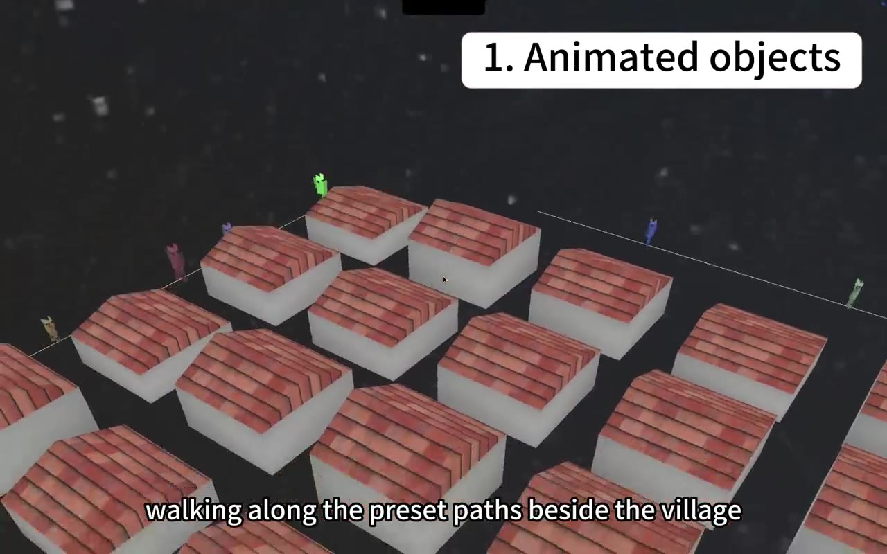
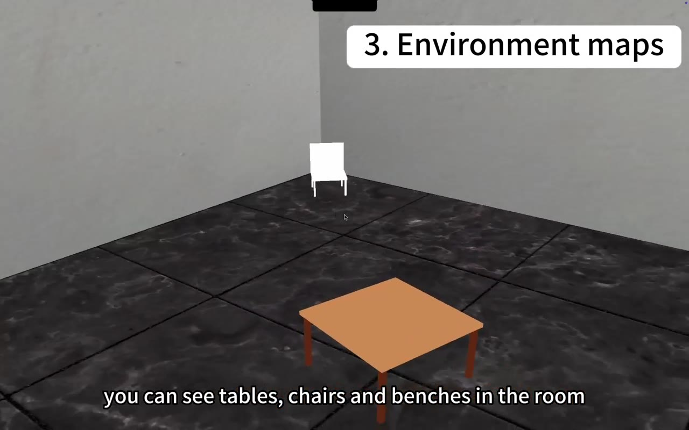
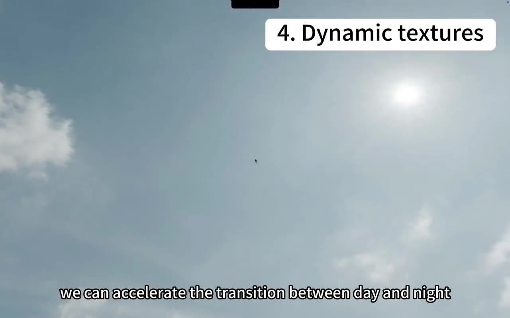

<<<<<<< HEAD
# Interactive 3D Village with OpenGL

An interactive, real-time **3D village** built in **C++17 and OpenGL 3.3** for a university Computer Graphics group project. The application combines procedurally assembled buildings, textured interiors, animated characters, particle effects, basic ball physics, and an animated day–night cubemap skybox in an explorable scene.



**Demo:** [Watch the 45-second project walkthrough](Demo.mp4) · **Course:** COMP4033 Computer Graphics · **Project:** Group 7

## Highlights

- **Procedural village layout:** Creates a **4 × 5 grid of 20 rooms** with randomized room heights, textured walls, floors, and roofs, plus furniture.
- **Path-following characters:** Spawns **20 animated, differently colored and scaled actors** that move along a closed waypoint path at varied speeds. Limb transformations create a simple walking animation.
- **Animated skybox:** Loads **day and night cubemap textures** and blends between them in GLSL; the transition rate can be adjusted during execution.
- **Particle effects:** Uses configurable point emitters, particle lifetimes and movement, and **instanced rendering** for torch/fire-like effects across the scene.
- **Interactive physics:** A textured football responds to a proximity-based kick, gravity, bouncing, friction, and simplified collision handling.
- **Free-camera exploration:** Supports first-person-style navigation, mouse-controlled viewing direction, fullscreen switching, and PNG screenshot capture.

## Demo and screenshots

The [`Demo.mp4`](Demo.mp4) walkthrough showcases the animated village, particles, textured rooms and skybox transition. These stills are extracted from that recording.

| Textured room | Daytime skybox |
| :--: | :--: |
|  |  |

## Implementation

| Component | Implementation | Source |
|---|---|---|
| Rendering pipeline | OpenGL 3.3 core profile, GLSL vertex/fragment shaders, depth testing | `src/GL-Project/main.cpp`, `src/GL-Project/shaders/` |
| Scene geometry | Generated room meshes, roof geometry, furniture and textured materials | `src/GL-Project/src/objects/Room.cpp`, `Chair.cpp`, `Table.cpp` |
| Animation | Distance-based path traversal and hierarchical limb transformations | `Actor.cpp`, `Path.cpp` |
| Environment | Two cubemaps blended through a time parameter | `Skybox.cpp`, `shaders/skybox.fs` |
| Particle effects | Point emitters, particle updates and `glDrawElementsInstanced` | `effects/ParticleSystem.cpp` |
| Interaction | Mouse-look, six-direction camera movement, keyboard controls | `main.cpp` |
| Basic physics | Football velocity, gravity, ground response and approximate room collisions | `Football.cpp`, `Scene.cpp` |

**Rendering scope:** Cubemap skyboxes and conventional 2D texture mapping are implemented. The supplied active fragment shaders do **not** implement reflective object materials or a shadow-map rendering pass. The source also contains lighting-related classes, but the active `basic.fs` shader does not perform per-pixel lighting calculations. These are possible future extensions rather than completed features.

### Scene construction

At startup, `main.cpp` creates 20 rooms in a grid with varied heights. Each is populated with four chairs and a table. A shared closed path is used by 20 animated actors, whose movement speeds and appearances vary. The scene manager updates the actors, ball and particle system before drawing the frame; the skybox renders afterward with translation removed from the view matrix.

### Day–night environment

`Skybox.cpp` loads six images for each cubemap from `textures/skybox/day/` and `textures/skybox/night/`. The skybox fragment shader blends the two sampled colors using an animated interpolation parameter. This changes the **background environment**, rather than implementing physically based changes to scene illumination.

## Controls

| Input | Action |
|---|---|
| `W` / `S` | Move forward / backward |
| `A` / `D` | Strafe left / right |
| `Q` / `E` | Move up / down |
| Mouse movement | Look around (cursor captured on launch) |
| `Space` | Kick the football when the camera is within 3 world units |
| `↑` / `↓` | Increase / decrease day–night transition speed |
| `H` | Toggle fullscreen |
| `O` | Save `screenshot.png` in the executable's current working directory |
| `Esc` | Exit |

## Tech stack

- **Language and graphics:** C++17, OpenGL 3.3, GLSL
- **Window and context:** GLFW
- **OpenGL loading and math:** GLAD, GLM
- **Textures:** stb_image
- **Build:** CMake
- **Additional dependencies referenced by the existing CMake configuration:** GLEW, Assimp, FreeType, FreeImage and macOS system frameworks

> Some dependencies and paths in the CMake file are inherited from the original project environment, even if they are not essential to every rendered feature. See the compatibility notes below.

## Repository structure

```text
.
├── CMakeLists.txt                # C++17 build configuration
├── run.sh                        # Script: build/run a named target from a source path
├── Demo.mp4                      # Recorded project walkthrough
├── README.md
├── docs/images/                 # README screenshots extracted from the demo
├── src/
│   ├── glad.c
│   ├── stb_image.cpp
│   └── GL-Project/
│       ├── main.cpp              # Window, input, scene setup and render loop
│       ├── include/
│       │   ├── objects/          # Room, Scene, Actor, Path, Chair, Table, Football, Skybox
│       │   └── effects/          # Particle and lighting interfaces
│       ├── src/
│       │   ├── objects/          # Object rendering and updates
│       │   └── effects/          # Particle and lighting implementations
│       ├── shaders/              # basic / particle / skybox GLSL programs
│       └── textures/             # Surface textures; day and night cubemaps
├── includes/                     # Bundled third-party headers
└── lib/                          # Platform-specific prebuilt libraries
```

`build/` and `bin/` are generated/build-output locations and are excluded by the repository's ignore rules. The compiled application loads shaders and textures via **relative paths**, so the working directory matters.

## Build and run (macOS)

The submitted CMake setup was configured for **Apple Silicon macOS** with Homebrew libraries under `/opt/homebrew`. It contains **hard-coded versioned GLFW paths** (specifically Homebrew `glfw/3.4`) and absolute Assimp / FreeImage paths. The following is a guide to the intended workflow, **not a verified clean-build recipe** on every machine.

**1. Install tools and libraries**

```bash
brew install cmake pkg-config glfw glew glm assimp freetype freeimage
```

**2. Check `CMakeLists.txt` for your actual installation paths**

The existing configuration references paths such as:

```text
/opt/homebrew/Cellar/glfw/3.4/include
/opt/homebrew/Cellar/glfw/3.4/lib/libglfw.3.4.dylib
/opt/homebrew/include
/opt/homebrew/lib/libassimp.dylib
/opt/homebrew/lib/libfreeimage.dylib
```

If these do not exist on your machine, update the paths in `CMakeLists.txt` or replace them with portable CMake package targets before configuring. Recent CMake versions may also require adding an appropriate `cmake_minimum_required(...)` declaration near the top of the file.

**3. Configure and build**

From the repository root:

```bash
cmake -S . -B build
cmake --build build --target GL-Project
```

**4. Run from the executable directory**

```bash
cd bin/GL-Project
./GL-Project
```

Running from `bin/GL-Project` is important because the application looks for `shaders/...` and `textures/...` relative to the current working directory. The CMake post-build steps copy those asset folders alongside the executable.

Alternatively, from the root directory, the bundled script accepts a **source-file path argument** and derives the `GL-Project` target name:

```bash
bash run.sh src/GL-Project/main.cpp
```

### Compatibility and troubleshooting

- The source requests **OpenGL 3.3 core** and an **800 × 600** initial window; actual support depends on the graphics driver and platform.
- macOS/Apple Silicon build paths are hard-coded. **Windows and Linux builds have not been verified** from this archive and may require CMake changes.
- If shaders or textures fail to load, run from `bin/GL-Project` rather than the repository root.
- Camera movement and the scene update loop use fixed per-frame increments (including `deltaTime = 0.016f`), so animation/movement speed may vary with actual frame rate.
- Screenshots are captured with the original `800 × 600` constants; after resizing or entering fullscreen, capture dimensions may not match the framebuffer.
- The supplied project includes `Demo.mp4` but no automated tests or portable CI configuration. A successful build/run on a fresh environment has **not** been independently verified here.

## Collaboration and credits

Created as a **Group 7** university Computer Graphics project by **Yixin Xia, Manxi Tao, Boxin Su and Junya Yang** (names shown in the recorded demo). The scene and codebase were developed collaboratively.

The project presentation and demo cover environment mapping/skybox work, animation, particles and textured scenes. Where individual contribution breakdown is important for a portfolio or application, it should be confirmed with the team before attributing specific modules to one person.

## Possible improvements

- Replace hard-coded Homebrew paths with portable, target-based CMake dependency discovery.
- Add actual reflective materials and a shadow-map rendering pass.
- Connect the lighting classes to an active lighting shader.
- Use true elapsed time for frame-independent animation and camera movement.
- Add automated build validation and platform-specific setup instructions.

---

*This repository documents a student graphics project and its learning outcomes; it is not a production rendering engine. Third-party libraries and image/texture assets may carry their own licenses—review those rights before redistributing or relicensing the full repository.*
=======
# Interactive-3D-Scene-OpenGL
An interactive OpenGL 3D environment featuring textured scenes, camera navigation, character animation, environment mapping, and shadow rendering.
>>>>>>> origin/main
